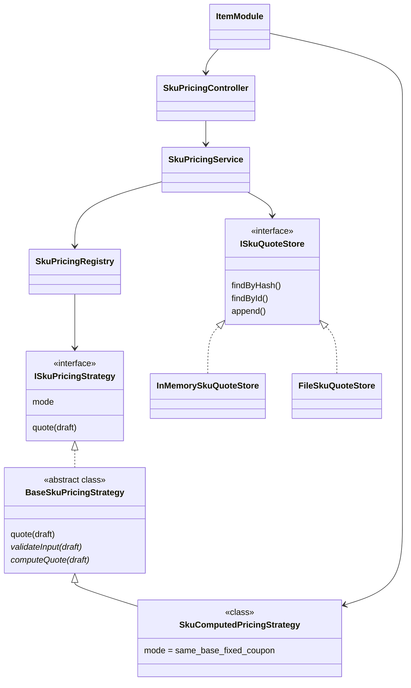

# 商品模块设计说明

版本：v1.0  
日期：2026-11-13  
模块：ItemModule  
公式：SKU-PRICING-R1  
当前模式：`same_base_fixed_coupon`

本文说明商品模块里每个 interface 和 class 的位置、职责和扩展方式。改定价规则、换存储或加接口时，先看第 2 节判断该动哪一层，再按第 6 节接入。

## 1. 模块边界

ItemModule 只做一件事：对一个已经取好数的订单测算场景做确定性计价，并通过 HTTP 返回结果。

调用链固定为：

```text
SkuPricingController
  -> SkuPricingService
    -> parseQuoteRequest
    -> preliminaryDecision
    -> SkuPricingRegistry.get(mode)
      -> ISkuPricingStrategy.quote
        -> BaseSkuPricingStrategy.quote
          -> 子类 validateInput / computeQuote
    -> ISkuQuoteStore
```

控制器不选择具体策略。策略不写存储、不采购、不改售价、不授权发布。`publish_authorized` 由 `SkuPricingService` 固定写成 `false`。

金额使用 `decimal.js`。请求里的金额和费率必须是十进制字符串。

## 2. 维护时先看这张分层

| 标记 | 含义 | 以后怎么改 |
| --- | --- | --- |
| `[interface]` | 对外约定。调用方只依赖它 | 改签名时同时改全部实现、测试和本文 |
| `[abstract class]` | 多个实现共用的模板 | 只放共同流程。子类必须实现的方法保持 abstract |
| `[class]` 扩展实现 | 某一种定价模式 | 新模式新增一个子类，不改已有公式类的内部 |
| `[class]` 装配 | Nest 模块和注册表 | 新实现要在这里注册。不要在控制器里写分支 |
| `[class]` 非扩展 | 入口、解析、存储实现 | 可以改内部，不要为了“整齐”再套一层基类 |
| `[data interface]` | 输入输出数据结构 | 不是策略。加字段时保持旧请求仍可解析 |
| `[function]` | 纯函数 | 无状态，可单独测试 |

只有定价策略是带模板方法的扩展点。报价存储有 interface，两个实现直接实现它，没有基类。



## 3. interface 与 class 清单

### 3.1 扩展点

| 名称 | 标记 | 文件 | 职责 | 扩展约束 |
| --- | --- | --- | --- | --- |
| `ISkuPricingStrategy` | `[interface]` | `src/item/pricing/i-sku-pricing-strategy.ts` | 一种定价模式的计算约定：`mode` 与 `quote(draft)` | 不能作为 DI Token。实现类通过基类继承 |
| `BaseSkuPricingStrategy` | `[abstract class]` | `src/item/pricing/base-sku-pricing-strategy.ts` | 模板方法 `quote`：先做共同拦截，再调用子类 | 禁止覆盖 `quote`。子类覆盖 `mode`、`validateInput`、`computeQuote` |
| `SkuComputedPricingStrategy` | `[class]` | `src/item/pricing/sku-computed-pricing.strategy.ts` | SKU-PRICING-R1 简化模式的具体公式 | 注册标识 `same_base_fixed_coupon`。新模式不要继承这个类 |

`quote` 的固定顺序：

1. `preliminaryDecision`：过期或场景不匹配、采购明确失败、缺项。
2. 子类 `validateInput`：模式、币种、费率、证据、采购数量、包裹运费。返回结果表示拒绝，返回 `null` 表示可以计算。
3. 子类 `computeQuote`：只负责公式和正向验算。

`ISkuPricingStrategy.quote` 无副作用。存储由服务层负责。

### 3.2 装配

| 名称 | 标记 | 文件 | 职责 |
| --- | --- | --- | --- |
| `AppModule` | `[class]` | `src/app.module.ts` | 进程入口模块。`forRoot()` 按环境变量装配 ItemModule |
| `ItemModule` | `[class]` | `src/item/item.module.ts` | 商品模块装配边界。`register()` 决定策略列表、必需模式和存储 |
| `ItemModuleRegisterOptions` | `[data interface]` | `src/item/item.module.ts` | `register()` 的选项：`requiredModes`、`quoteStore`、`quoteStorePath`、`strategyTypes` |
| `SkuPricingRegistry` | `[class]` | `src/item/pricing/sku-pricing.registry.ts` | 构造时按 `mode` 建表。重复注册或缺少必需模式会在启动时抛错 |
| `SkuPricingOptions` | `[data interface]` | `src/item/pricing/sku-pricing.tokens.ts` | 注册表和存储工厂读到的运行选项 |

DI Token 都是 Symbol，不是 interface：

| Token | 提供的对象 |
| --- | --- |
| `SKU_PRICING_STRATEGIES` | `ISkuPricingStrategy[]` |
| `SKU_PRICING_OPTIONS` | `SkuPricingOptions` |
| `SKU_QUOTE_STORE` | `ISkuQuoteStore` |

`ItemModule` 导出 `SkuPricingService`、`SkuPricingRegistry`、`SKU_QUOTE_STORE` 和 `SKU_PRICING_STRATEGIES`。其他模块只能依赖这些导出，不能引用定价策略的私有方法。

### 3.3 服务入口

| 名称 | 标记 | 文件 | 职责 |
| --- | --- | --- | --- |
| `SkuPricingController` | `[class]` | `src/item/pricing/sku-pricing.controller.ts` | `POST /pricing/quote`，`GET /pricing/quotes/:calculationId`。不选择策略类 |
| `SkuPricingService` | `[class]` | `src/item/pricing/sku-pricing.service.ts` | 解析、按 mode 取策略、保存结果、相同输入复用。强制 `publish_authorized: false` |

这两个类是非扩展点，基类不适用。新增 HTTP 路径时改控制器，并继续把计算交给服务。

### 3.4 存储

| 名称 | 标记 | 文件 | 职责 |
| --- | --- | --- | --- |
| `ISkuQuoteStore` | `[interface]` | `src/item/pricing/sku-quote.store.ts` | `findByHash`、`findById`、`append`。相同输入摘要拒绝第二次写入 |
| `InMemorySkuQuoteStore` | `[class]` | 同文件 | 进程内存实现。测试和 `SKU_QUOTE_STORE=memory` 使用 |
| `FileSkuQuoteStore` | `[class]` | 同文件 | JSONL 追加实现。默认路径 `data/sku-quotes.jsonl` |
| `StoredQuote` | `[data interface]` | `src/item/pricing/sku-pricing.types.ts` | 一条不可变历史：`calculationId`、`inputHash`、`createdAt`、`response` |

存储实现直接实现 `ISkuQuoteStore`，不设抽象基类。换数据库时新增一个 class，在 `ItemModule.register` 的存储工厂里选择它。

### 3.5 数据契约

这些 interface 描述一次计算的数据，不是可替换策略。

| 名称 | 标记 | 文件 | 职责 |
| --- | --- | --- | --- |
| `SkuPricingDraft` | `[data interface]` | `src/item/pricing/sku-pricing.types.ts` | 解析后的测算草稿。金额是 Decimal，`null` 表示缺项 |
| `ReadySkuPricingDraft` | `[data interface]` | 同文件 | 缺项已被拦截后的草稿。必填金额不再为 null |
| `FeeDraft` | `[data interface]` | 同文件 | 一条费用。含基数、费率和是否出现封顶、阶梯、门槛 |
| `ProcurementLineDraft` | `[data interface]` | 同文件 | 一条采购明细，供数量和货款校验 |
| `ShippingParcelDraft` | `[data interface]` | 同文件 | 一个包裹的地址和运费 |
| `PurchaseMappingDraft` | `[data interface]` | 同文件 | 已核实状态下必须提供的销售 SKU 与采购 SKU 映射 |
| `PricingComputation` | `[data interface]` | 同文件 | 策略返回的计算结果，尚不含计算编号 |
| `PricingDetail` | `[data interface]` | 同文件 | 公式明细，便于核对和复盘 |
| `SkuQuoteResponse` | `[data interface]` | 同文件 | HTTP 与存储使用的完整响应。继承 `PricingComputation` |
| `CalculationStatus` | `[type]` | 同文件 | `calculated`、`estimated`、`needs_input`、`unsupported_rule`、`invalid_procurement`、`needs_requote`、`invalid_input` |
| `FeeRounding` | `[type]` | 同文件 | `unrounded_estimate`、`per_item_half_up`、`per_item_ceil` |

`SkuQuoteResponse` 在 `PricingComputation` 上增加 `formula_version`、`calculation_id`、`publish_authorized`、`reused` 和 `created_at`。策略不要自己填这五个字段。

### 3.6 函数

| 名称 | 标记 | 文件 | 职责 |
| --- | --- | --- | --- |
| `parseQuoteRequest` | `[function]` | `src/item/pricing/parse-quote-request.ts` | 把 JSON 解析成草稿。JSON 数字直接判为 `invalid_input` |
| `preliminaryDecision` | `[function]` | `src/item/pricing/pricing-precheck.ts` | 所有模式共用的过期、采购失败和缺项拦截 |
| `evaluateProcurementLine` | `[function]` | `src/item/pricing/procurement-quantity.ts` | 采购数量公式。不满足起订量或步长时失败，不向上取整 |
| `canonicalRequestHash` | `[function]` | `src/item/pricing/request-hash.ts` | 相同数值的十进制写法得到同一个摘要 |
| `emptyComputation` | `[function]` | `src/item/pricing/pricing-result.ts` | 构造带默认空字段的计算结果 |
| `ceilToCent`、`formatMoney`、`formatRate`、`formatContribution` | `[function]` | `src/item/pricing/decimal-money.ts` | 十进制舍入和输出格式 |

`ProcurementQuantityResult`、`ProcurementQuantityOk`、`ProcurementQuantityFail` 是采购函数的返回形状，标记为 `[data interface]`，文件在 `procurement-quantity.ts`。

## 4. 请求经过哪些类型


状态优先级由 `preliminaryDecision` 和策略一起保证：

1. 请求体不是对象：控制器返回 HTTP 400。
2. 字段类型无法解释：`invalid_input`。
3. 证据过期或场景不匹配：`needs_requote`。
4. 采购校验明确失败：`invalid_procurement`。
5. 必填字段为 null：`needs_input`。
6. 模式未注册，或规则含不同基数、封顶、阶梯、补贴：`unsupported_rule`。
7. 证据和舍入规则都已核实：`calculated`。
8. 输入仍是假设，或费用未按平台规则取整：`estimated`。

亏损和刚好为 0 的贡献用金额表示，不占用失败状态。

## 5. 当前公式类的内部职责

`SkuComputedPricingStrategy` 只处理 `same_base_fixed_coupon`。

它读取的草稿字段是整单口径。`sales_quantity` 只标识场景，不再次乘到货款、运费和目标上。

计算关系：

```text
C = goods_total + supplier_shipping + other_purchase_cost
K = C + selling_fixed_cost + after_sale_reserve
r = 基数为 merchant_gross_income 的费率之和
目标收入 = max((K + T) / (1 - r), K / (1 - r - m))
最低标价 = 向上取到分(目标收入 + 固定商家券)
```

最低价返回前会再走正向公式。逐项舍入使目标未达到时，标价每次加 `0.01` 后重算。候选价只验算，不把用户给出的价格向下改。

已核实结果还必须同时具备：`procurement_validation = passed`、证据引用、核验时间、销售 SKU、采购映射，以及不是 `unrounded_estimate` 的舍入规则。

## 6. 后续扩展

### 6.1 新增一种定价模式

1. 新建 class，继承 `BaseSkuPricingStrategy`，不要继承 `SkuComputedPricingStrategy`。
2. 用 `override` 实现 `mode`、`validateInput`、`computeQuote`。不要声明 `quote`。
3. 类注释写明所属模块、interface、直接基类、注册标识、覆盖成员和禁止覆盖的方法。
4. 在 `ItemModule.register({ strategyTypes, requiredModes })` 中加入该类。生产默认列表仍保留 `SkuComputedPricingStrategy`。
5. 未支持的计费规则返回 `unsupported_rule`，不要把不同基数的费率合并进简化公式。
6. 为新 mode 增加契约测试，并确认原模式 `same_base_fixed_coupon` 的示例结果不变。
7. 更新本文第 3.1 节和 `docs/interface-base-class-map.md`。

模式字符串就是注册标识。`SkuPricingRegistry` 发现重复 `mode` 或缺少 `requiredModes` 时，模块创建失败。

### 6.2 更换报价存储

1. 新建 class，直接实现 `ISkuQuoteStore`。
2. `append` 在摘要已存在时抛错，禁止覆盖旧记录。
3. 在 `ItemModule` 的 `SKU_QUOTE_STORE` 工厂中选择新实现。
4. 用临时目录做读写测试：重启后能读到第一条，第二条不同输入可以追加。

### 6.3 增加接口字段

响应可以增加字段。已有字段的含义保持不变，尤其是：

- `calculation_status`
- `purchase_cost`
- `minimum_merchant_income`
- `minimum_list_price`
- `candidate_contribution_unrounded`
- `target_met_in_this_scenario`
- `publish_authorized`

缺项继续用 `null` 和 `missing_fields` 表达，不用 `0` 代替。

## 7. 不要改动的约束

- 不要把 `ISkuPricingStrategy` 或 `ISkuQuoteStore` 直接注册成 DI Token。
- 不要在 `SkuPricingController` 里根据 mode 创建策略对象。
- 不要让 `SkuComputedPricingStrategy` 保存请求级字段。它是单例，只持有不变的 `mode`。
- 不要在策略里把 `publish_authorized` 设为 true。
- 不要用二进制浮点计算金额。
- 测试里的替换策略可以放在 `test/`，不能进入 `AppModule.forRoot()` 的默认装配。

## 8. 相关文档

| 文档 | 内容 |
| --- | --- |
| `docs/modules/item.md` | 模块开发卡、配置、拆除条件 |
| `docs/extensions/sku-computed-pricing-strategy.md` | 当前公式类的行为和公式 |
| `docs/interface-base-class-map.md` | interface 到源码、测试、文档的索引 |
| `docs/diagrams/sku-pricing-flow.md` | 一次报价的状态分支 |
| `docs/diagrams/sku-pricing-inheritance.md` | 策略继承图 |
| `examples/quote.example.json` | 可直接调用的示例请求 |
